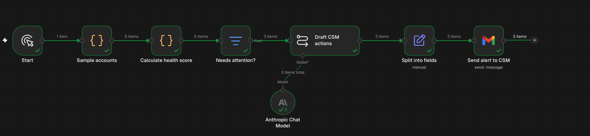

# n8n Customer Success Playbook

n8n workflows that help a Customer Success Manager (CSM) keep an enterprise portfolio healthy. All data in this repo is **sample data**.

## Project 1: Customer Health Monitor

### The problem
A CSM managing around 30 enterprise accounts can't watch every usage dashboard every day. Risks like falling usage, silent teams and piling-up tickets get noticed too late, often just before renewal.

### What I built
An n8n workflow that scores every account, picks out the ones that need attention, and has Claude draft a diagnosis and a check-in email. The CSM gets one alert per at-risk account in their inbox.

**Flow:** Start → Sample accounts → Calculate health score → Needs attention? → Draft CSM actions (Claude) → Split into fields → Send alert to CSM

### How the health score works
Each account starts at 100 points and loses points for four signals:

| Signal | Why it matters |
|---|---|
| Usage change vs the previous 30 days | A big drop often means the product is losing its place in daily work |
| Days since last login | Long silence suggests the champion left or priorities shifted |
| Active users | Few users means the account depends on one or two people |
| Open support tickets | Unresolved friction is a leading churn signal |

Accounts score **Healthy** (75+), **Watch** (50-74) or **At risk** (below 50). Only accounts that are not Healthy go to Claude.

### Human in the loop
Claude drafts, the CSM decides. The email goes to the CSM for review and is never sent to the customer automatically.

### Example output

### How I'd explain this to a customer
"We look at how your team uses n8n each month. If activity drops or tickets stay open, we notice early and reach out to help before it becomes a problem. You get proactive support instead of waiting for something to break."

### Setup
1. Import `Customer Health Monitor.json` into n8n (menu, **Import from file**).
2. Connect your own Anthropic and Gmail credentials.
3. Set the recipient in the Gmail node (it is `csm@example.com` here).
4. Click **Execute workflow**.

### Next steps
- Connect real product usage data instead of sample accounts
- Tune the thresholds with CSM feedback
- Log outcomes to measure which alerts led to saved accounts

## Coming next
- 02 Customer onboarding kit
- 03 QBR and ROI report generator
- 04 Renewal and expansion radar
