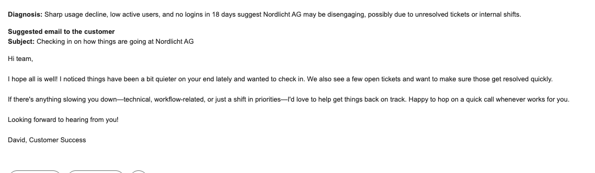
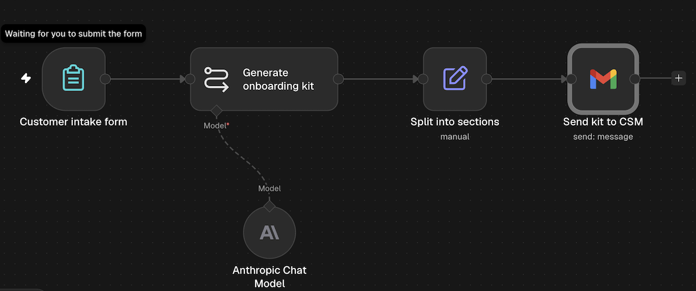
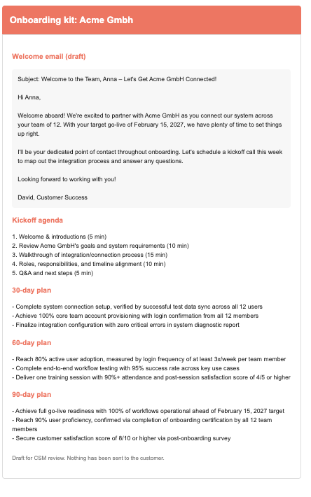

# n8n Customer Success Playbook

n8n workflows that help a Customer Success Manager (CSM) keep an enterprise portfolio healthy. Every project starts with a one-page plan (problem, one-sentence solution, five questions about the flow) before anything is built. All data in this repo is **sample data**.

---

## Project 1: Customer Health Monitor

### 1 · Problem
*What goes wrong today? For whom? How often?*

A CSM managing around 30 enterprise accounts can't watch every usage dashboard every day. Falling usage, silent teams and piling-up tickets get noticed too late, often just before renewal.

### 2 · Solution in one sentence
*When [trigger], then [result] should happen for [whom], so that [benefit].*

> When the weekday schedule runs, then a diagnosis and a draft check-in email should be created for the CSM, so that at-risk accounts get attention early.

### 3 · Sketch: five questions about the flow

| Step | Question | Answer |
|---|---|---|
| **Start** | What triggers the flow? | Schedule trigger (manual trigger in this demo) |
| **In** | What data arrives? Which fields? | Company, executions (last 30 days vs the previous 30), active users, days since last login, open tickets |
| **Do** | What happens to the data? | Each account gets a score out of 100. Healthy accounts are filtered out. Claude writes a diagnosis and a check-in email for the rest |
| **Out** | What comes out at the end? | One alert email per at-risk account with diagnosis, subject line and draft email |
| **Human** | Who looks at it before anything goes out? | The CSM reviews and decides. Nothing is sent to the customer automatically |

### How the health score works
Each account starts at 100 points and loses points for four signals:

| Signal | Why it matters |
|---|---|
| Usage change vs the previous 30 days | A big drop often means the product is losing its place in daily work |
| Days since last login | Long silence suggests the champion left or priorities shifted |
| Active users | Few users means the account depends on one or two people |
| Open support tickets | Unresolved friction is a leading churn signal |

**Healthy** is 75 or above, **Watch** is 50 to 74, **At risk** is below 50. Only accounts that are not Healthy go to Claude.

### Example output

### How I'd explain this to a customer
"We look at how your team uses n8n each month. If activity drops or tickets stay open, we notice early and reach out to help before it becomes a problem. You get proactive support instead of waiting for something to break."

### Setup
1. Import `Customer Health Monitor.json` into n8n (menu, **Import from file**).
2. Connect your own Anthropic and Gmail credentials.
3. Set the recipient in the Gmail node (it is `csm@example.com` here).
4. Click **Execute workflow**.

### Next steps
- Connect real product usage data instead of sample accounts
- Tune the thresholds with CSM feedback
- Log outcomes to measure which alerts led to saved accounts

---

---

## Project 2: Customer Onboarding Kit

### 1 · Problem
*What goes wrong today? For whom? How often?*

After a deal closes, a CSM has to prepare a welcome email, a kickoff agenda and a success plan for every new customer. It takes time, and the quality varies from one customer to the next.

### 2 · Solution in one sentence
*When [trigger], then [result] should happen for [whom], so that [benefit].*

> When a new customer submits the intake form, then a welcome email, kickoff agenda and 30/60/90-day plan should be drafted for the CSM, so that onboarding starts fast and consistently.

### 3 · Sketch: five questions about the flow

| Step | Question | Answer |
|---|---|---|
| **Start** | What triggers the flow? | A new customer submits the intake form |
| **In** | What data arrives? Which fields? | Company, contact name, main goal, team size, target go-live date |
| **Do** | What happens to the data? | Claude drafts the welcome email, kickoff agenda and 30/60/90-day plan. The answer is split into sections |
| **Out** | What comes out at the end? | One formatted email to the CSM with the full kit |
| **Human** | Who looks at it before anything goes out? | The CSM edits and sends it. Nothing is sent to the customer automatically |

### How it works
**Flow:** Customer intake form → Generate onboarding kit (Claude) → Split into sections → Send kit to CSM

- The **intake form** collects five fields: company, name, main goal, team size and go-live date.
- **Claude** writes the kit in a fixed structure, so every customer gets the same sections.
- A small step **splits the answer** into welcome email, agenda and three plans.
- The **CSM receives one formatted email** with everything in separate sections, marked as a draft.

### Example output

### How I'd explain this to a customer
"As soon as you tell us your goal and your go-live date, we prepare a clear plan for your first 90 days: who does what, and what success looks like at 30, 60 and 90 days. You start with a plan instead of a blank page."

### Setup
1. Import `Customer Onboarding Kit.json` into n8n (menu, **Import from file**).
2. Connect your own Anthropic and Gmail credentials.
3. Set the recipient in the Gmail node (it is `csm@example.com` here).
4. Click **Execute workflow**, then fill in the form that opens.

### Next steps
- Save each kit to a CRM record or a shared drive
- Add a reminder for the CSM to review the draft within one working day
- Track time from signature to kickoff to measure the effect

---

## Roadmap
- 03 QBR and ROI report generator
- 04 Renewal and expansion radar
